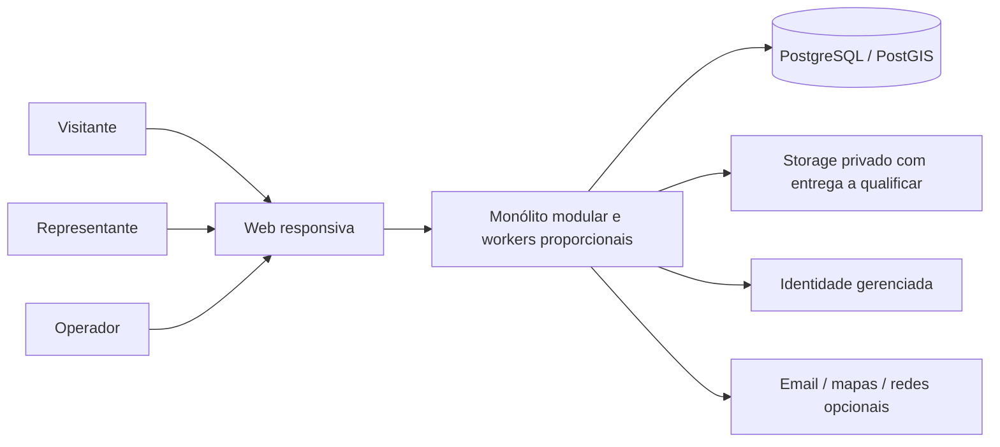

# Arquitetura de planejamento

Direção aceita no [review CTO 02](../governance/sources/cto-technical-review-02.md): monólito modular independente, web responsiva, PostgreSQL/PostGIS, identidade gerenciada como princípio, objetos compatíveis com S3 como princípio e integrações substituíveis. Next.js/TypeScript é candidato preferencial, não stack congelada ou fornecedor contratado. [ADRs](ADR-REGISTER.md) detalham estados.

Limites de confiança: navegador não confiável, aplicação/autorização, banco e objetos privados, provedores externos. PostgreSQL é fonte autoritativa de estados; representação pública autorizada é a única fonte de geografia pública. Identidade pessoal não se confunde com identidade institucional. [Pesquisa WP-02](../research/WP02-DOCUMENTARY-QUALIFICATION.md) compara candidatos, sem comprovar desempenho ou acesso comercial.

Não há justificativa aprovada para microsserviços prematuros, Kubernetes, infraestrutura vetorial, apps nativos ou IA obrigatória. Workers, caches e mídia exigem proporção ao piloto; nenhuma dessas peças foi provisionada.

## Residuais

- T01: NORMATIVE_DIRECTION_APPROVED conforme mandato NI: PUBLICATION_ELIGIBLE e PUBLIC_EXPOSURE_ALLOWED distintos; disputa admitida impede publicação inicial/republicação; denúncia ou admissão não suspende automaticamente perfil já publicado; restrições exigem autoridade humana e fundamento; retirada de consentimento interrompe exposição controlada. Contrato NOT_FROZEN, sem resolver T02 por inferência.
- T02: perda do último representante requer política de recuperação, sem transferência automática; exposição e consentimento precisam de regra explícita.
- T03: restaurar backup antigo não pode ressuscitar autorizações revogadas; reconciliar eventos posteriores ou manter público bloqueado. Fonte recente independente do rollback e procedimentos ainda devem ser qualificados.
- T04: mídia privada com entrega controlada versus checagem de borda; URL temporária sozinha não garante retirada imediata. Falhas e custos ainda não testados.

Contratos C01–C09 no [planejamento 0.2](../planejamento/m01/planejamento-tecnico-rev-0.2.md) foram aceitos em nível de desenho, com condições. C10, jurídica, economia e operação impedem declarar prontidão. [Estado corrente](../status/CURRENT-STATUS.md).

Atualização independente da recepção integral: direção T01 preservada conforme [mandato NI](../governance/sources/normative-integration-mandate-01.md). NI-G01 PASS por completude das fontes; a Rev. 1.1 está ratificada e vigente por aditivo, C10 aguarda integração definitiva e aceite CTO. Não se alteram stack ou fornecedores, nem se declaram testes executados. [Manifesto](../governance/SOURCE-MANIFEST.md).

## Vigência normativa e preparação do aceite final KF

A [deliberação presidencial](../governance/decisions/m01-presidential-ratification-01.md) ratificou integralmente a Rev. 1.1, sem condições adicionais, em 2026-11-27. A [revisão CTO NI](../governance/reviews/cto-ni-final-review-01.md) aceitou NI-01–05 com 16 PASS. São eventos distintos, registrados conforme o [mandato de finalização](../governance/sources/knowledge-foundation-finalization-mandate-01.md), sem reiniciar planejamento ou reconciliação.

**PRESIDENTIAL_RATIFICATION APPROVED; NORMATIVE_BASELINE RATIFIED; EFFECTIVE_DATE 2026-11-27; EFFECTIVE TRUE.** Ler o [mandato integral preservado](../governance/mandates/m01-consolidated-mandate-1.1.md) com o [aditivo de vigência](../governance/mandates/m01-normative-effectiveness-01.md). Objeto aprovado: fe105fefbf685ffa9a5eb37988f3ca4e22e9d13b, blob 22ce8ac5087cfb1c633f3b266f35776965c09733. O arquivo aprovado não mudou; seus estados de submissão são históricos e a vigência decorre dos registros posteriores. Fontes 9/9 e essenciais 7/7; NI-G01 PASS; matriz e COR-01–06 aceitas pelo CTO.

A dependência normativa substantiva de C10 está resolvida; classificação definitiva **PENDING_FINAL_CTO_ACCEPTANCE**. AC-KF-03-R1 **BLOCKED** para PASS definitivo até integração definitiva publicada sob autorização específica, recuperação remota independente e aceite CTO. [Matriz AC-KF final proposta](../validation/AC-KF-FINAL-PROPOSED.md), [VAL finalização](../validation/VAL-KF-FINALIZATION-01.md) e [handoff](../status/KF-FINALIZATION-HANDOFF.md).

DEC-01–16 e COR-01–06 preservadas; DEC-16 APPROVED_FRAMEWORK. T01 NORMATIVE_DIRECTION_APPROVED, contrato técnico NOT_FROZEN; T02–T04 OPEN, WP-02–04 com seus gates. Engineering Readiness NOT_ESTABLISHED; contratos de domínio NOT_FROZEN. Construção continua PROPOSED_FOR_EXECUTIVE_AUTHORIZATION, sem aprovação automática dos 26 CONSTRUCTION:AC-*; namespaces MVP/CONSTRUCTION/CONSOLIDATED mantidos. Testes de aplicativo NOT_EXECUTED.

Gate corrente: **CTO_KNOWLEDGE_FOUNDATION_FINAL_ACCEPTANCE_REVIEW**. Prontidão para revisão não é aceite integral concedido. Commit/push/merge, KF-06, app/implementação, fornecedores, compromissos financeiros, infraestrutura e deploy NOT_AUTHORIZED. Evidências históricas permanecem nos respectivos checkpoints e arquivos; o estado corrente deve ser lido por este aditivo e pelo registro de ratificação.
