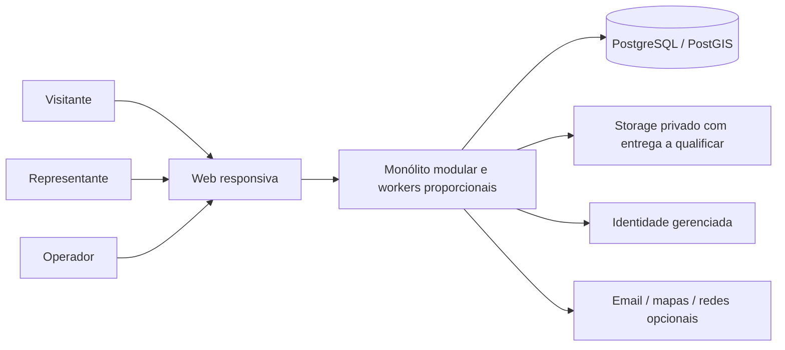

# Arquitetura de planejamento

Direção aceita no [review CTO 02](../governance/sources/cto-technical-review-02.md): monólito modular independente, web responsiva, PostgreSQL/PostGIS, identidade gerenciada como princípio, objetos compatíveis com S3 como princípio e integrações substituíveis. Next.js/TypeScript é candidato preferencial, não stack congelada ou fornecedor contratado. [ADRs](ADR-REGISTER.md) detalham estados.

Limites de confiança: navegador não confiável, aplicação/autorização, banco e objetos privados, provedores externos. PostgreSQL é fonte autoritativa de estados; representação pública autorizada é a única fonte de geografia pública. Identidade pessoal não se confunde com identidade institucional. [Pesquisa WP-02](../research/WP02-DOCUMENTARY-QUALIFICATION.md) compara candidatos, sem comprovar desempenho ou acesso comercial.

Não há justificativa aprovada para microsserviços prematuros, Kubernetes, infraestrutura vetorial, apps nativos ou IA obrigatória. Workers, caches e mídia exigem proporção ao piloto; nenhuma dessas peças foi provisionada.

## Residuais

- T01: NORMATIVE_DIRECTION_APPROVED conforme mandato NI: PUBLICATION_ELIGIBLE e PUBLIC_EXPOSURE_ALLOWED distintos; disputa admitida impede publicação inicial/republicação; denúncia ou admissão não suspende automaticamente perfil já publicado; restrições exigem autoridade humana e fundamento; retirada de consentimento interrompe exposição controlada. Contrato NOT_FROZEN, sem resolver T02 por inferência.
- T02: perda do último representante requer política de recuperação, sem transferência automática; exposição e consentimento precisam de regra explícita.
- T03: restaurar backup antigo não pode ressuscitar autorizações revogadas; reconciliar eventos posteriores ou manter público bloqueado. Fonte recente independente do rollback e procedimentos ainda devem ser qualificados.
- T04: mídia privada com entrega controlada versus checagem de borda; URL temporária sozinha não garante retirada imediata. Falhas e custos ainda não testados.

Contratos C01–C09 no [planejamento 0.2](../planejamento/m01/planejamento-tecnico-rev-0.2.md) foram aceitos em nível de desenho, com condições. C10 foi resolvida; jurídico, economia, operação, contratos e qualificações ainda impedem declarar prontidão. [Estado corrente](../status/CURRENT-STATUS.md).

Atualização independente da recepção integral: direção T01 preservada conforme [mandato NI](../governance/sources/normative-integration-mandate-01.md). NI-G01 PASS por completude das fontes; a Rev. 1.1 está ratificada e vigente por aditivo, C10 está definitivamente resolvida pelo aceite CTO. Não se alteram stack ou fornecedores, nem se declaram testes executados. [Manifesto](../governance/SOURCE-MANIFEST.md).

## Aceite KF vigente e bootstrap restrito do App

O [aceite final CTO](../governance/reviews/cto-kf-final-acceptance-01.md), recebido na [fonte integral](../governance/sources/kf-final-acceptance-and-app-bootstrap-01.md), encerra Phase 00A/00B como CLOSED — ACCEPTED, KF-01–05 COMPLETE, NI COMPLETE — ACCEPTED, C10 RESOLVED_BY_SOURCE_RECONCILIATION_AND_AUTHORIZED_NORMATIVE_REBASELINE e AC-KF-03-R1 PASS. [Matriz aceita](../validation/AC-KF-ACCEPTED-01.md): 13 PASS, 0 FAIL, 0 BLOCKED e 2 NOT_EXECUTED antes do KF-06. O agente registra a determinação expressa; recuperação remota independente e aceite pertencem ao CTO.

Checkpoint documental aceito **dad48511595f1d0fa3d06590da222cc0fabaef0a**; mandato M01 1.1 ratificado em fe105fefbf685ffa9a5eb37988f3ca4e22e9d13b, blob 22ce8ac5087cfb1c633f3b266f35776965c09733, RATIFIED — EFFECTIVE desde 2026-11-27. Instrumento aprovado, aditivo, fontes, VALs/JSONs e redlines preservados. O aceite do checkpoint não constitui autorização retroativa genérica das operações Git.

KF-06 / Phase 00C **AUTHORIZED_FOR_RESTRICTED_BOOTSTRAP** pelo mandato ANCESTRALIDADE-CTO-MANDATE-KF06-01. [REQ](../engineering/REQ-APP-BOOTSTRAP-01.md), [IMP](../engineering/IMP-APP-BOOTSTRAP-01.md), [VAL](../validation/VAL-APP-BOOTSTRAP-01.md) e [handoff](../status/APP-BOOTSTRAP-HANDOFF.md). ancestralidade/app foi criado pelo usuário e confirmado PRIVATE, vazio, branch main; clone local com cinco arquivos mínimos preparados. Criação/visibilidade verificadas, sem commit do agente. Referências normativas do app apontam a SHA e blobs de docs, sem cópia da autoridade normativa. Registros novos de execução ainda locais aguardam SHA de publicação após autorização.

AC-KF-14/15 continuam sem PASS definitivo até integração autorizada, recuperação independente e aceite CTO. Engineering Readiness NOT_ESTABLISHED, contratos de domínio NOT_FROZEN; T01 NORMATIVE_DIRECTION_APPROVED e contrato NOT_FROZEN; T02–T04 OPEN; WP-02–04 com seus gates; DEC-16 APPROVED_FRAMEWORK. Mandato de construção PROPOSED_FOR_EXECUTIVE_AUTHORIZATION, 26 critérios sem aprovação automática. Nenhum teste de aplicativo executado.

Gate corrente: **CTO_APPLICATION_REPOSITORY_BOOTSTRAP_REVIEW**. Commit/push/merge, implementação M01/Phase 01, dependências/frameworks, stack definitiva, banco, infraestrutura, contratação, compromissos financeiros, políticas organizacionais e deploy NOT_AUTHORIZED. Esta execução reúne registro do aceite e bootstrap, sem outra intervenção documental exclusiva de encerramento.
