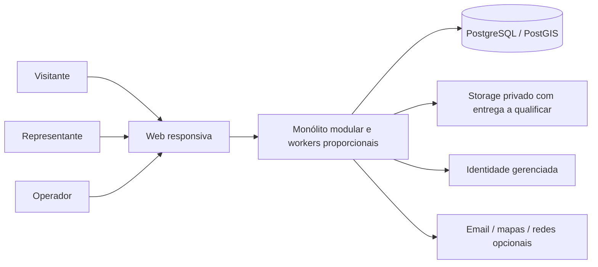

# Arquitetura de planejamento

Direção aceita no [review CTO 02](../governance/sources/cto-technical-review-02.md): monólito modular independente, web responsiva, PostgreSQL/PostGIS, identidade gerenciada como princípio, objetos compatíveis com S3 como princípio e integrações substituíveis. Next.js/TypeScript é candidato preferencial, não stack congelada ou fornecedor contratado. [ADRs](ADR-REGISTER.md) detalham estados.

Limites de confiança: navegador não confiável, aplicação/autorização, banco e objetos privados, provedores externos. PostgreSQL é fonte autoritativa de estados; representação pública autorizada é a única fonte de geografia pública. Identidade pessoal não se confunde com identidade institucional. [Pesquisa WP-02](../research/WP02-DOCUMENTARY-QUALIFICATION.md) compara candidatos, sem comprovar desempenho ou acesso comercial.

Não há justificativa aprovada para microsserviços prematuros, Kubernetes, infraestrutura vetorial, apps nativos ou IA obrigatória. Workers, caches e mídia exigem proporção ao piloto; nenhuma dessas peças foi provisionada.

## Residuais

- T01: NORMATIVE_DIRECTION_APPROVED conforme mandato NI: PUBLICATION_ELIGIBLE e PUBLIC_EXPOSURE_ALLOWED distintos; disputa admitida impede publicação inicial/republicação; denúncia ou admissão não suspende automaticamente perfil já publicado; restrições exigem autoridade humana e fundamento; retirada de consentimento interrompe exposição controlada. Contrato NOT_FROZEN, sem resolver T02 por inferência.
- T02: perda do último representante requer política de recuperação, sem transferência automática; exposição e consentimento precisam de regra explícita.
- T03: restaurar backup antigo não pode ressuscitar autorizações revogadas; reconciliar eventos posteriores ou manter público bloqueado. Fonte recente independente do rollback e procedimentos ainda devem ser qualificados.
- T04: mídia privada com entrega controlada versus checagem de borda; URL temporária sozinha não garante retirada imediata. Falhas e custos ainda não testados.

Contratos C01–C09 no [planejamento 0.2](../planejamento/m01/planejamento-tecnico-rev-0.2.md) foram aceitos em nível de desenho, com condições. C10, jurídica, economia e operação impedem declarar prontidão. [Estado corrente](../status/CURRENT-STATUS.md).

Atualização independente da recepção integral: direção T01 preservada conforme [mandato NI](../governance/sources/normative-integration-mandate-01.md). NI-G01 PASS por completude das fontes; a minuta 1.1 está preparada, C10 segue aberta até os gates de ratificação/integração. Não se alteram stack ou fornecedores, nem se declaram testes executados. [Manifesto](../governance/SOURCE-MANIFEST.md).

## Estado sincronizado — integração normativa preparada

Mesma [REQ NI](../engineering/REQ-NORMATIVE-INTEGRATION-01.md) e [continuação CTO](../governance/reviews/cto-execution-continuation-02.md), checkpoint f103f129da7ee2eaffc747d07b96b99b9db74226. Fontes 9/9 e essenciais 7/7 recebidas/inspecionadas: **NI-G01 PASS** para completude documental. [Manifesto](../governance/SOURCE-MANIFEST.md). [Matriz bidirecional](../validation/M01-NORMATIVE-TRACEABILITY.md), [minuta 1.1 de 36 seções](../governance/mandates/m01-consolidated-mandate-1.1.md) e [redline](../governance/mandates/m01-consolidated-mandate-1.0-to-1.1-redline.md) preparados. COR-01–06 incorporadas à minuta; ratificação presidencial **PENDING**, sem vigência definida. A–G aprovados com condições na SOURCE-07, confirmados em SOURCE-09, não são ratificação do novo texto 1.1.

DEC-01–16 preservadas, DEC-16 APPROVED_FRAMEWORK; T01 NORMATIVE_DIRECTION_APPROVED, contrato NOT_FROZEN; T02–T04/WP-02–04 mantêm gates. C10 OPEN — RECONCILIATION_PREPARED_PENDING_REVIEW; AC-KF-03-R1 BLOCKED até ratificação, integração autorizada, recuperação independente e aceite CTO. Engineering Readiness NOT_ESTABLISHED. Testes de aplicativo NOT_EXECUTED. [VAL final](../validation/VAL-NORMATIVE-INTEGRATION-FINAL-01.md), [handoff](../status/NI-FINAL-DELIVERY-HANDOFF.md) e [estado corrente](../status/CURRENT-STATUS.md). Gate de parada: CTO_NORMATIVE_BASELINE_INTEGRATION_REVIEW; nenhum commit/push/merge, KF-06 ou implementação autorizado.
