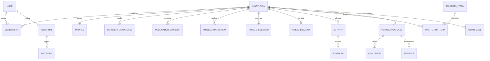
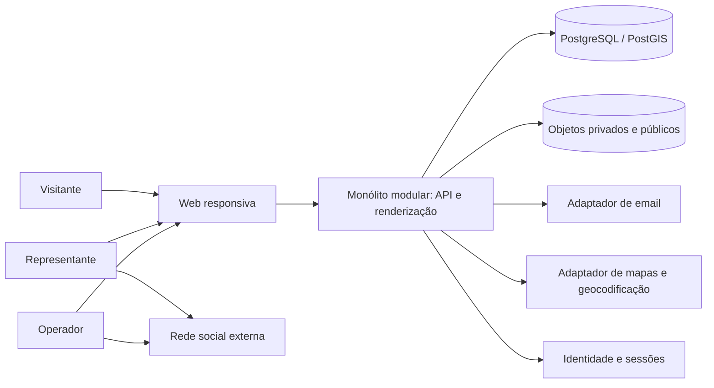
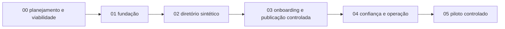

> Referência histórica preservada. O corpo abaixo mantém a revisão e seus estados da primeira entrega; DEC-10–16 foram deliberadas posteriormente e o mandato KF autoriza agora a execução documental local. Consulte [CURRENT-STATUS](../../status/CURRENT-STATUS.md) e o [índice canônico](../../README.md) para a situação corrente. Não usar esta página isoladamente como autorização atual.

# Ancestralidade.org — Planejamento técnico M01

**Revisão:** 0.2, 26/11/2026. Incorpora CTO-ANCESTRALIDADE-M01-TP-REVIEW-01 (APPROVED_WITH_CORRECTIONS); contratos não congelados. **Estado:** proposta para revisão CTO. O planejamento e a pesquisa estão autorizados; implementação, contratação e deploy não. Fontes: mandato técnico e três revisões anexadas. O mandato superior completo não foi fornecido: os títulos AC-01–18 devem ser confrontados com o original. Recomendações e estimativas abaixo não constituem decisões aprovadas.

**Resultado:** monólito modular independente, web responsiva, PostgreSQL/PostGIS e integrações substituíveis são uma arquitetura plausível. A viabilidade nacional, operacional e econômica ainda não está demonstrada. **Classificação:** PRODUCT_DECISION_REQUIRED e FEASIBILITY_LIMITATION_IDENTIFIED. Não há evidência suficiente para declarar a Phase 00 completa ou liberar implementação. Próximo gate: CTO_ANCESTRALIDADE_M01_TECHNICAL_PLANNING_REVIEW_02.

## Decisões

| ID | Assunto | Estado e consequência |
|---|---|---|
| DEC-01–09 | diretório M01, modularidade, perfis, indicação privada, publicação condicionada, ausência de espera mínima e verificação em dois níveis | aprovadas conforme mandato; vinculantes |
| DEC-10 | critérios de representação | produto pendente; bloqueia regra final de aprovação |
| DEC-11 | visibilidade geográfica | produto pendente; proposta pública/aproximada/reservada |
| DEC-12 | moderação, suspensão e disputas | produto pendente |
| DEC-13 | operação administrativa | produto pendente; capacidade e SLAs não estabelecidos |
| DEC-14 | taxonomia | produto pendente; modelo técnico pode avançar |
| DEC-15 | renovação e revogação de selo | produto pendente |
| DEC-16 | economia e titularidade | decisão executiva pendente; contratação bloqueada |

## TP-01 — Requisitos e domínio

Todos os requisitos abaixo derivam do mandato técnico, seções 4 e 8–12, e são P0. As condições explícitas do mandato são vinculantes; detalhes afetados por DEC-10–16 permanecem propostos. O aceite descreve testes futuros, não executados.

| ID / tipo | Requisito e dependência | Aceite futuro |
|---|---|---|
| R01 funcional | pesquisa pública sem conta; depende de publicação | visitante encontra apenas instituições elegíveis; AC-01 |
| R02 negócio | instituição tem identidade independente de usuário; DEC-10 | revogar conta não destrói instituição; AC-03/15 |
| R03 segurança | autorização por instituição e confirmação de canais | email sozinho não prova representação; acesso cruzado é negado; AC-04/15 |
| R04 negócio | publicação exige representação, consentimento, triagem, contatos aplicáveis e ausência de disputa de representação não resolvida admitida; denúncia recebida não equivale a disputa | ausência de condição bloqueia; última aprovação permite publicação imediata; AC-05/06/13 |
| R05 privacidade | retirada de consentimento interrompe exposição controlada; DEC-12 | API, perfil, pesquisa, mapa e cache deixam de expor; AC-14 |
| R06 funcional | indicação identificada, privada e independente de cadastro | indicação não gera perfil público; recusa e convites registrados; AC-07 |
| R07 funcional | selo opcional: desafio social ou verificação manual equivalente; DEC-15 | ambos podem conceder mesmo selo; expiração impede aprovação; AC-10/11 |
| R08 privacidade | pesquisa utiliza só representação geográfica autorizada; DEC-11 | buscas repetidas não inferem coordenada privada; AC-02/17 |
| R09 funcional | perfis, contatos, atividades e horários | filtros combinados referem-se à mesma atividade; AC-08/09 |
| R10 funcional | taxonomia extensível e autodeclaração; DEC-14 | múltiplos termos e aliases revisáveis sem alterar código |
| R11 operacional | fila e decisões humanas fundamentadas; DEC-12/13 | denúncia isolada não suspende; decisão é auditável; AC-13/16 |
| R12 segurança | isolamento, auditoria, proteção de mídia e recuperação | testes BOLA, abuso, upload e restore; AC-15/16 |
| R13 não funcional | independência do Axodus Core, acessibilidade, mobile e recuperação | sem dependência obrigatória; metas demonstradas por ensaios; AC-18 |
| R14 privacidade | minimizar coleta e histórico sensível | busca não exige religião do visitante; jurídico valida bases e retenção |

### Modelo proposto



IDs persistentes independentes de slug; vínculo ativo único por usuário e instituição, com papel e datas. Perfil e localização pública corrente são únicos por instituição. Casos, evidências e consentimentos são históricos; consentimento registra versão, escopo, ator e data. Localização privada opcional não ingressa na projeção pública. Indicação não cria instituição nem vínculo automaticamente. Atividades possuem condição econômica, público e recorrência semanal com fuso; exceções dependem de decisão. Termos têm aliases e estado de revisão sem substituir autodeclaração.

Excluir conta revoga acesso e inicia tratamento de dados pessoais sem excluir automaticamente a instituição. Retenção, anonimização, evidências e backups dependem de parecer jurídico; não há prazo aprovado. Controle otimista de versão e eventos auditáveis em alterações críticas.

### Papéis e estados

| Papel | Permissão proposta |
|---|---|
| visitante | ler apenas dados publicados |
| usuário | gerir própria conta e indicações; sem administração por padrão |
| representante validado | editar instituição e conceder consentimento, no escopo do vínculo |
| administrador delegado | editar e delegar somente o que lhe foi concedido |
| editor | editar campos delegados, sem poderes de representação ou publicação |
| moderador | atuar nos casos atribuídos e registrar decisão fundamentada |
| administrador da plataforma | operação com menor privilégio e acesso excepcional auditado |

Backend valida papel, vínculo ativo, instituição, estado e versão a cada ação. MFA para operadores e ações sensíveis é proposta. Estados independentes: conta PENDING→ACTIVE↔SUSPENDED; email PENDING→CONFIRMED; representação PENDING→VALIDATED→CONTESTED/REVOKED; consentimento PENDING→GRANTED→WITHDRAWN; triagem PENDING→APPROVED/REJECTED; publicação DRAFT→UNDER_REVIEW→PUBLISHED→SUSPENDED/ARCHIVED; selo NOT_REQUESTED→PENDING→VERIFIED→REVOKED. Operador decide representação e triagem; representante concede ou retira consentimento; reversões exigem nova validação aplicável e auditoria. Uma disputa não transfere autoridade.

`PUBLICATION_ELIGIBLE = contatos_confirmados AND representacao_validada AND consentimento_vigente AND triagem_aprovada AND NOT disputa_admitida_nao_resolvida`. Denúncia recebida não é disputa admitida. Para perfil já publicado, toda restrição exige decisão humana autorizada: ver contrato C06 abaixo e conflito de interpretação pendente. Transição de publicação e invalidação de condição serializam por instituição, verificam versão e registram evento; ações repetidas usam idempotência. Suspensão ou retirada devem interromper exposição antes de confirmar sucesso. A política de disputa e reativação depende de DEC-12.

### Indicação e verificação

Indicação → avaliação privada e duplicidade provável → convite autorizado pelo operador → adesão voluntária → cadastro oficial → representação, consentimento e triagem. Limitar abuso, registrar recusa e não fundir duplicados automaticamente; cadência e retenção estão pendentes. Selo social: desafio aleatório, temporário, de uso único e vinculado à instituição, solicitante e perfil → card e texto → URL informada → revisão humana do canal, postagem e código. Proposta: validade configurável inicial de 48 h. O código público não autentica nem recupera conta. Método manual independente usa evidência proporcional e concede o mesmo selo; não solicitar documentos ou biometria indiscriminadamente. Nenhum selo certifica legitimidade religiosa.

## TP-02 — Arquitetura e viabilidade



Limites de confiança: navegador → aplicação; aplicação → banco e objetos privados; integrações externas e redes sociais. Módulos: identidade, instituição, representação, consentimento, publicação, busca, taxonomia, atividades, indicação, verificação, mídia, moderação e auditoria. Workers podem rodar separadamente sem criar microsserviços. Ambientes DEV/STAGING/PROD devem ter segredos, acesso, banco e dados segregados.

Fluxo: entrada validada → autorização → transação de domínio e auditoria → projeção pública autorizada → API, HTML e mapa. Dados privados e evidências nunca entram na projeção. Despublicação e redução geográfica exigem controle autoritativo atual em todas as leituras públicas, falha fechada e invalidação durável e monitorada; uma CDN capaz de servir conteúdo antigo sem controle não atende retirada imediata. Não é possível garantir remoção de cópias de terceiros.

### ADRs propostos

| Decisão | Recomendação | Alternativa / trade-off |
|---|---|---|
| ADR-01 | monólito modular e workers, menor coordenação operacional | microsserviços isolam deploy, mas acrescentam complexidade |
| ADR-02 | PostgreSQL/PostGIS para transações e geografia | busca externa adiciona sincronização; reavaliar após medição |
| ADR-03 | Next.js/TypeScript, backend modular, validação por schema e SQL parametrizado | Django/Python oferece outra opção madura; escolha depende de equipe e avaliação técnica |
| ADR-04 | identidade por solução madura com MFA e sessões revogáveis | IAM próprio exige maior manutenção; fornecedor ainda não escolhido |
| ADR-05 | objetos privados e públicos através de contrato S3 compatível | solução integrada reduz operação, mas amplia dependência |
| ADR-06 | verificação manual como caminho funcional | automação social depende de permissões e aprovações não verificadas |

Todas são propostas, sem teste de desempenho, versões, licenças ou seleção definitiva. API documentada em OpenAPI, logs estruturados, métricas e testes de integração são recomendações. Provedores externos não são fonte de autoridade religiosa.

### Busca e privacidade geográfica

**DEC-11 ainda pendente:** PUBLIC divulga endereço e ponto autorizados; APPROXIMATE apenas região/bairro autorizado; RESERVED município e contato. A busca usa exclusivamente a representação pública; ponto privado não participa de filtro, ordenação, contagem, paginação nem cluster. Busca por raio retorna dois grupos: `nearby`, com distância em linha reta apenas para PUBLIC, e `regional`, com correspondência de localidade autorizada, sem afirmar que a instituição está dentro do raio. Critério de região, limites e tratamento de fronteiras dependem de produto. Sem distância, rota ou marcador individual para localização protegida.

Contrato proposto: `GET /institutions` recebe texto, termo, município, atividade, dia, condição econômica, coordenadas e raio autorizados e cursores; retorna dois grupos e cursores independentes. Resultado protegido não inclui coordenadas ou distância. `GET /institutions/{id}/{slug}` usa ID estável; alterar slug redireciona sem revelar dados históricos protegidos. Filtros de atividade devem ser satisfeitos pela mesma atividade. Limitar raio, página e volume de consultas; pesquisar município e CEP só com dados divulgáveis.

Para pontos PUBLIC, propor `geography(Point,4326)` com índice GiST, `ST_DWithin` para filtrar em metros e `ST_Distance` para ordenação; `geometry` em graus não equivale a metros. Limites e escalabilidade devem ser medidos com dados sintéticos representativos. Distância geodésica não é rota. [PostGIS ST_DWithin](https://postgis.net/docs/ST_DWithin.html). Reduzir exposição aplica-se imediatamente; ampliá-la exige confirmação expressa, conforme proposta pendente. Ensaiar resposta, contagem, ordenação, SEO, mapas e cache para evitar inferência. Imagens podem revelar endereço mesmo sem EXIF.

### Mídia, provedores e ameaças

Upload proposto: URL restrita e temporária, quarentena privada, limite configurável, verificação do conteúdo real, decodificação segura, remoção de metadados, thumbnails e moderação antes de publicar. Conteúdo público precisa de mecanismo de revogação efetivo: links assinados já emitidos e caches antigos exigem atenção. Não hospedar vídeo diretamente. Cards usam template determinístico SVG/PNG, sem IA obrigatória e sem selo antecipado.

| Categoria | Alternativas para avaliação | Restrição ou lacuna |
|---|---|---|
| identidade | Supabase Auth / serviço de identidade independente | verificar MFA, migração, residência e custo |
| hospedagem e banco | serviços gerenciados / máquina administrada pelo time | PostGIS, backups, disponibilidade e custo operacional pendentes |
| objetos | Cloudflare R2 / Amazon S3 | comparar políticas, custo, CDN e remoção |
| mapas e geocodificação | provedores comerciais / serviço baseado em OSM | qualidade no Brasil, licenciamento, limites e custos pendentes |
| email | Resend / Amazon SES | entregabilidade, dados, preço e região pendentes |
| observabilidade | serviço gerenciado / operação interna | retenção e dados sensíveis devem ser limitados |
| Instagram, Facebook, Threads, TikTok, YouTube e X | links externos / integração oficial por plataforma | incorporação, autoria, legenda e validação automática: NOT_ESTABLISHED; documentar API, conta, permissões, revisão, limites, custo e região por rede |

A disponibilidade pública de uma postagem não autoriza coleta programática. A revisão manual deve funcionar sem APIs; não usar scraping não autorizado. Não houve teste de provedor.

Ameaças prioritárias e mitigação: tomada de conta → MFA administrativo, sessões seguras e recuperação revisada; representação fraudulenta → validação proporcional e disputa humana; BOLA → autorização por instituição e testes; inferência de endereço → projeção pública separada e testes diferenciais; abuso de denúncias → análise humana; XSS/CSRF/SQLi/SSRF → codificação, CSP, sessões protegidas, SQL parametrizado e proibição de busca arbitrária por URL; upload malicioso → quarentena e decodificação isolada; extração e spam → limites e monitoramento; exposição de evidências → acesso mínimo auditado; perda de dados → backups criptografados e restore exercitado; abuso administrativo → segregação de funções e auditoria. Resposta a incidentes, responsáveis e prazos precisam ser definidos antes do piloto.

Dados relacionados a convicção religiosa ou filiação religiosa vinculados a pessoa natural podem ser dados pessoais sensíveis; consentimento institucional de publicação não define automaticamente a base jurídica de cada tratamento. Jurídico deve avaliar finalidade, bases, direitos, retenção, transferência internacional, operadores e incidentes. [LGPD, art. 5º](https://www.planalto.gov.br/ccivil_03/_ato2015-2018/2018/lei/l13709compilado.htm), [ANPD](https://www.gov.br/anpd/pt-br/acesso-a-informacao/perguntas-frequentes).

## TP-03 — Capacidade e economia

### Carga ilustrativa

Premissas mensais não validadas: 5 visitantes/instituição, 2 buscas e 2 perfis/visitante, metade das buscas geográficas, 0,1 conta ativa/instituição, 5 MB de mídia/instituição, 1 MB de transferência/perfil, 0,1 upload, 0,02 caso e 0,06 email por instituição; 0,05 geocodificação, 0,005 verificação e 0,002 denúncia por instituição. São cenários de dimensionamento, não previsão comercial. Frações de eventos nos menores cenários representam médias estatísticas.

| Cenário | Instituições | visitantes | contas | buscas / geo | perfis | uploads | mídia GB | tráfego GB | casos / emails | geocode / selo / denúncias |
|---|---:|---:|---:|---:|---:|---:|---:|---:|---:|---:|
| S1 | 100 | 500 | 10 | 1.000 / 500 | 1.000 | 10 | 0,5 | 1 | 2 / 6 | 5 / 0,5 / 0,2 |
| S2 | 1.000 | 5.000 | 100 | 10.000 / 5.000 | 10.000 | 100 | 5 | 10 | 20 / 60 | 50 / 5 / 2 |
| S3 | 10.000 | 50.000 | 1.000 | 100.000 / 50.000 | 100.000 | 1.000 | 50 | 100 | 200 / 600 | 500 / 50 / 20 |
| S4 | 100.000 | 500.000 | 10.000 | 1.000.000 / 500.000 | 1.000.000 | 10.000 | 500 | 1.000 | 2.000 / 6.000 | 5.000 / 500 / 200 |

Tráfego contempla apenas mídia de perfil. Para banco, 2 GB fixos + 50 KB/instituição resulta em aproximadamente 2,005 / 2,05 / 2,5 / 7 GB; índices, histórico e crescimento podem alterar os valores. Duas cópias completas representam cerca de 4 / 4,1 / 5 / 14 GB de banco e 1 / 10 / 100 / 1.000 GB de mídia. Retenção não está aprovada. Recursos hipotéticos de aplicação para S1–S4: respectivamente 1–2 / 1–2 / 2–4 / 4–8 vCPU e 2–4 / 2–4 / 4–8 / 8–16 GB RAM; banco adicional 1–2 / 1–2 / 2–4 / 4–8 vCPU e 2–4 / 2–4 / 4–8 / 8–16 GB. Essas faixas não demonstram capacidade ou alta disponibilidade; testar picos antes de contratar.

### Tarifas e custo parcial

Fontes consultadas em 26/11/2026: [Supabase](https://supabase.com/pricing) Pro a partir de US$25/mês e [FAQ](https://supabase.com/docs/guides/platform/billing-faq) ilustra três projetos Micro por US$45/mês; [Cloudflare R2 Standard](https://developers.cloudflare.com/r2/pricing/) US$0,015/GB-mês com franquia de 10 GB e operações cobradas; [Resend](https://resend.com/pricing) gratuito até 3.000 emails/mês e 100/dia, Pro US$20/mês até 50.000. Tarifas em USD, sujeitas a alteração, franquias e condições.

Exemplo parcial, não custo operacional total: três projetos Micro US$45 + armazenamento R2 acima de 10 GB (S1/S2 US$0, S3 US$0,60, S4 US$7,35) + email (S1–S3 US$0 se limites diários forem respeitados, S4 US$20) = US$45 / 45 / 45,60 / 72,35 por mês. Exclui aplicação, operações de objetos, tráfego adicional, backup de mídia, mapas, geocodificação, DNS, monitoramento, suporte, tributos e equipe. Três Micros não foram dimensionados para S3 ou S4. Portanto não são custos totais viáveis: obter cotações e medir a carga antes do gate, sem assumir contratação.

### Capacidade administrativa

Capacidade diária = operadores × horas produtivas × 60 / minutos por caso. Exemplo: 2 × 5 × 60 / 10 = 60 casos/dia. Para 50 chegadas e 20% de retrabalho adicional, a carga é 60 atendimentos/dia e não há margem. Com uma ausência, capacidade cai para 30 e backlog cresce 30 atendimentos/dia. Com 45 casos de 10 min e 5 casos complexos de 30 min, são 600 min; com 20% de retrabalho são 720 min, exigindo 3 operadores de 5 h produtivas após arredondamento. `backlog seguinte = max(0, backlog anterior + demanda equivalente − capacidade)`. Tempo de espera depende da distribuição e prioridades. Medir eventual redução de trabalho por automação; não presumir automação de decisões contestadas.

### WBS incremental — proposta revisada

As horas são estimativas por estágio, não autorizações, compromissos ou valores comerciais. O incremento sintético da Phase 02 depende de dados fictícios e não autoriza publicar instituições reais. Segurança e privacidade mínimas integram cada entrega.

| Fase | Entrega demonstrável e exclusões | Perfis principais | Base sem reserva | Reserva 20% | Total |
|---|---|---|---:|---:|---:|
| 01 Foundation | identidade, banco, autorização e infraestrutura mínima; sem instituições reais publicadas | backend/DevOps | 360 | 72 | 432 |
| 02 Core Directory | cards, perfil, busca, filtros, geografia e atividades com dados sintéticos; sem onboarding público | frontend/UX/backend | 580 | 116 | 696 |
| 03 Institutional Onboarding | representação, consentimento, triagem e publicação controlada; depende das decisões e regras de segurança | backend/UX/QA | 530 | 106 | 636 |
| 04 Trust & Operations | indicação, selo social e manual, denúncias e moderação; sem automação social obrigatória | full stack/QA/operação | 500 | 100 | 600 |
| 05 Controlled Pilot | testes integrados, correções, prontidão e piloto autorizado | QA/engenharia/produto | 450 | 90 | 540 |
| Total futuro | fases 01–05; todas NOT_AUTHORIZED | multidisciplinar | 2.420 | 484 | 2.904 |

As 2.420 h incluem a distribuição indicativa de discovery 100, arquitetura 120, UX 160, frontend 320, backend 400, dados 180, integrações 160, backoffice 200, segurança 120, QA 240, DevOps 140, documentação 80 e piloto/correções 200; tratam de esforço futuro residual, sem duplicar a Phase 00 já executada, e devem ser refinadas por tarefa. Otimista 2.300 h, base 2.904 h, conservador 4.000 h são cenários agregados não derivados de medições. Sem tarifas fornecidas, custo de cada incremento = soma(horas de cada perfil × tarifa aprovada) + despesas de ambiente e fornecedores; a tabela de perfis e horas por fase precisa ser detalhada para orçamentação. Não se pode determinar custo monetário ou composição contratual sem taxas do cliente e CFO. A divisão entre fases é hipótese inicial, não cotação validada.

Entregas postergáveis entre incrementos são exercidas apenas após validação com produto; indicação e verificação manual permanecem obrigatórias para o M01 completo e para a conclusão da fase 04. Segurança, autorização, consentimento, triagem e integridade não podem ser postergados para depois da publicação real. Os 2.904 h / (3 pessoas × 120 h produtivas/mês) = 8,1 meses são somente uma razão aritmética: habilidades, caminho crítico, disponibilidade e retrabalho não são modelados. Viabilidade de custo e cronograma não estabelecida.

## TP-04 — Engineering readiness



Sequência proposta pelo CTO: a Phase 02 pode demonstrar descoberta com dados sintéticos. A primeira publicação real exige representação validada, consentimento, triagem, confirmações aplicáveis, privacidade e demais controles obrigatórios; não depende do selo avançado. O piloto integral M01 ocorre depois da Phase 04. DEC-10/11/12 influenciam os contratos; DEC-13/16 e parecer jurídico condicionam a operação e o financiamento. A fatia futura validará cadastro, confirmação de canal, instituição, representação, consentimento, triagem, publicação, busca e perfil. Nenhuma implementação foi autorizada.

| REQ → IMP → VAL futuro | Escopo / dependências | Aceite / gate |
|---|---|---|
| 01 → 01 → 01 | identidade, vínculo e instituição; DEC-10 | AC-03/04/15; DOMAIN_CONTRACT_REVIEW |
| 02 → 02 → 02 | consentimento e publicação; pacote 01 | AC-05/06/12/13/14; DOMAIN_CONTRACT_REVIEW |
| 03 → 03 → 03 | busca, geografia, atividades; DEC-11/14 | AC-01/02/08/09/17; ARCHITECTURE_REVIEW |
| 04 → 04 → 04 | indicação e verificação; DEC-15 | AC-07/10/11; DOMAIN_CONTRACT_REVIEW |
| 05 → 05 → 05 | operação, segurança e auditoria; DEC-12/13 | AC-13/15/16 e restore; FEASIBILITY_REVIEW |
| 06 → 06 → 06 | piloto e validação integrada; anteriores | AC-01–18; MVP_IMPLEMENTATION_READINESS_REVIEW |

Cada IMP está NOT_AUTHORIZED. Detalhar responsabilidades, restrições e entregáveis antes do gate.
### Aceitação e evidências

| AC | Verificação futura |
|---|---|
| 01 | visitante pesquisa sem login; rascunhos ausentes |
| 02 | rota e distância somente quando autorizadas |
| 03 | cadastro independente da conta pessoal |
| 04 | canal confirmado; email não comprova representação |
| 05 | toda condição de publicação é obrigatória |
| 06 | última aprovação permite publicar sem espera mínima |
| 07 | indicação privada não publica automaticamente |
| 08 | card e perfil respeitam exposição autorizada |
| 09 | condições de visitação e atividades são corretas |
| 10 | selo opcional social; desafio expirado recusado |
| 11 | processo manual oferece selo equivalente |
| 12 | estados separados; revogar selo não apaga perfil |
| 13 | denúncia isolada não despublica; disputa admitida impede nova publicação; transferência e eventual restrição exigem decisão autorizada |
| 14 | retirada interrompe exposição controlada inclusive caches |
| 15 | usuário sem vínculo não acessa nem altera outra instituição |
| 16 | ações críticas registram ator, data, motivo e resultado |
| 17 | endereço protegido não vaza por API, SEO, mapa ou consultas repetidas |
| 18 | nenhum componente Axodus Core é obrigatório |

Testes futuros: unidades para regras, integração e concorrência de transações, contratos de API, autorização por papel/estado, privacidade por consultas diferenciais, geoespacial, segurança, end-to-end, acessibilidade por teclado/leitor, performance S1–S4 e restore. DEV/STAGING usam dados sintéticos e segredos isolados. Evidência inclui versão, ambiente, cenário, resultado e responsável. Metas propostas a validar: p95 de busca no servidor <1 s sob carga de piloto, disponibilidade mensal 99,5%, RPO 24 h e RTO 8 h; não são garantias.

### Piloto e riscos

Piloto proposto de 4–6 semanas, com 10–30 instituições voluntárias de tradições diversas, em região escolhida pelo cliente. Medir tempos por caso, fila, retrabalho, recusas, incidentes, geografia, acessibilidade, custos e satisfação. Antes de iniciar: responsabilidades, revisão jurídica, critérios de interrupção e autorização de contato; limiares de aprovação ainda não estabelecidos.

| Risco | Probabilidade / impacto preliminar | Mitigação / responsável / gate |
|---|---|---|
| representação falsa | média / alta | validação e contestação humanas; produto; domínio |
| inferência ou vazamento de endereço | média / alta | projeção segregada e fail-closed; segurança; arquitetura |
| intolerância e abuso de denúncias | alta / alta | decisão fundamentada e revisão; produto; piloto |
| saturação da triagem | alta / alta | medir e financiar equipe; operação/CFO; viabilidade |
| indisponibilidade de redes sociais | alta / média | verificação manual; engenharia; arquitetura |
| custos imprevistos | média / alta | cotações e ensaios; CTO/CFO; viabilidade |
| dados sensíveis e exposição jurídica | média / alta | minimização e revisão jurídica; controlador; piloto |
| dados incorretos ou baixa adesão | média / alta | revisão e piloto voluntário; produto; piloto |
| perda de dados ou indisponibilidade | média / alta | backup, restore e monitoramento; engenharia; readiness |
| dependência de fornecedor | média / média | contratos e exportação; CTO; arquitetura |

Julgamentos preliminares, sem base estatística; todos permanecem abertos.

### Trabalho pendente antes do aceite

1. Obter mandato superior completo e confrontar os ACs; detalhar rastreabilidade e responsáveis.
2. Decidir DEC-10–16 e definir política de disputas, taxonomia, selo e operação.
3. Pesquisar individualmente capacidades oficiais das seis redes e comparar dois fornecedores por categoria, com preços, licença, região e termos.
4. Fechar custos totais por cenário e ambiente, inclusive aplicação, mapas, backup, pessoal, impostos e taxas; revisar com CFO.
5. Validar bases legais, retenção, incidentes, transferência e direitos; demonstrar remoção em superfícies controladas.
6. Revisar alternativas de stack, ameaças, SLOs, capacidade e piloto; comprovar desempenho e recuperação com ensaios posteriores.

### Handoff

```yaml
project: ANCESTRALIDADE.ORG
business_unit: AXODUS_BUSINESS
classification: CLIENT_PROJECT
module: M01
phase: PHASE_00
planning:
  requirements: DRAFT_REVIEW_REQUIRED
  domain_model: DRAFT_REVIEW_REQUIRED
  architecture: PROPOSED_NOT_VALIDATED
  provider_feasibility: INCOMPLETE
  security_privacy: PRELIMINARY_LEGAL_REVIEW_REQUIRED
  economics: PARTIAL_NOT_ESTABLISHED
  engineering_readiness: NOT_ESTABLISHED
decisions:
  approved: DEC-01_TO_DEC-09
  pending: DEC-10_TO_DEC-16
  blockers: [REPRESENTATION, GEOGRAPHY, MODERATION, OPERATIONS, TAXONOMY, BADGE, ECONOMICS, LEGAL, PROVIDER_EVIDENCE]
authorization:
  technical_planning: AUTHORIZED
  implementation: NOT_AUTHORIZED
  commit: NOT_AUTHORIZED
  push: NOT_AUTHORIZED
  merge: NOT_AUTHORIZED
  deploy: NOT_AUTHORIZED
  commercial_commitment: NOT_AUTHORIZED
next_gate: CTO_ANCESTRALIDADE_M01_TECHNICAL_PLANNING_REVIEW_02
```


## Complemento normativo da revisão 0.2 — correções CTO

Este complemento detalha e, em caso de ambiguidade, prevalece sobre a revisão 0.1. Os critérios de produto ainda pendentes são propostas, não decisões aprovadas. A aprovação arquitetural do CTO é em princípio; Phase 00, contratos e engenharia não estão liberados.

### C01 — Contratos de apresentação

| Campo público | Card | Perfil completo | Origem, regra e ausência |
|---|---|---|---|
| ID, slug, URL | link estável | identidade e link canônico | Institution/Profile; slug muda sem mudar identidade; redirecionar somente se elegível |
| Nome e tradição | obrigatório | obrigatório | nome institucional e classificações autodeclaradas; catálogo aprovado pendente |
| Capa | prevista | prevista | mídia autorizada; usar imagem neutra quando ausente; imagem não é condição de publicação presumida |
| Logo | opcional | opcional | mídia autorizada; fallback tipográfico |
| Município e UF | sim | sim | localização autorizada; nunca mostrar localização privada |
| Distância | quando autorizada | quando autorizada | somente nível público; linha reta; omitir quando desconhecida ou protegida |
| Visitação | resumo | descrição | declaração institucional ou por atividade, sem inferir abertura de ausência |
| Agendamento e condição econômica | resumo qualificado | detalhe por atividade | valores declarados, ver C03; mostrar «não informado» quando ausente |
| Descrição e história | curta / sem história | descrição e história | texto livre validado, codificado e sanitizado; ausência não gera conteúdo inventado |
| Orientações | resumo se informado | completas se informadas | vestimenta, contato e acessibilidade conforme declaração |
| Atividades e horários | resumo das atividades declaradas | lista e recorrência | não prometer próxima ocorrência em feriados ou exceções sem suporte explícito |
| Galeria e redes | redes opcionais | galeria e links quando informados | apenas conteúdo autorizado; embeds condicionados à C07 |
| Contato | opcional | disponível quando informado | canal institucional autorizado, nunca contato privado de indicação |
| Selo | quando concedido | quando concedido | somente verificação avançada vigente; ausência não é irregularidade |

API/SSR expõem o mesmo conjunto autorizado por superfície. Sem campos com valor desconhecido assumido como falso; acessibilidade inclui texto alternativo e indicação textual de estados. Capa/logo e contato opcionais dependem da política de publicação aplicável; o sistema não exige que informação ausente seja inventada.

**Aceite C01:** fixture elegível com todos os campos declarados deve renderizar o conjunto apropriado em card e perfil; fixture sem imagem, contato ou atividade deve renderizar fallbacks sem dados inventados; dado privado, institucional suspenso ou localização protegida não aparece em HTML, API, SEO ou mídia.

### C02 / C05 — Representantes, consentimento e selo

Invariante: **representação institucional ≠ autenticidade institucional ≠ legitimidade religiosa**. A primeira avalia autoridade para agir pelo perfil, é obrigatória para publicação; a segunda é evidência complementar opcional e pode gerar selo; a terceira é julgamento doutrinário fora da competência da plataforma. Uma pessoa pode ter vínculos distintos em várias instituições e uma instituição pode ter vários representantes. Cada vínculo registra escopo, estado, início, fim, concessor e evidência mínima; atos de publicação e consentimento exigem representante validado e autorizado para aquele ato. Delegações para edição não equivalem automaticamente a representação.

Consentimento é versão de texto e escopo de exposição concedidos pelo representante autorizado, com ator e data. Proposta sujeita a DEC-10/12: um representante com permissão expressa pode retirar consentimento e suspender exposição; a revogação de um vínculo não apaga automaticamente os demais. Se o último representante válido deixar de existir, bloquear mudanças críticas e abrir recuperação humana; efeito sobre publicação e transição do consentimento dependem de produto e jurídico, não são automaticamente presumidos. Substituição mediante caso humano, evidência proporcional, decisão auditada, revogação do vínculo antigo quando aplicável e concessão explícita do novo; disputa não transfere acesso.

**Aceite:** dois representantes autorizados podem coexistir; revogar A não dá acesso a terceiro nem revoga automaticamente B; editor não concede consentimento; retirada por ator autorizado encerra exposição; selo não é exigido e sua revogação não altera representação nem despublica por si só.

### C03 — Semântica de atividades

Activity tem identidade, nome, descrição e estado; WeeklySchedule contém dia, hora local e fuso. Campos distintos, com valor UNKNOWN quando não informados: `public_access` (OPEN/RESTRICTED/CLOSED/UNKNOWN), `service_mode` (PRESENTIAL/REMOTE/HYBRID/OTHER/UNKNOWN), `appointment` (REQUIRED/OPTIONAL/NOT_REQUIRED/UNKNOWN) e `economic_condition` (FREE/VOLUNTARY_CONTRIBUTION/PAID/OTHER/UNKNOWN). Valores são propostas a validar com produto. Atividade paga ou contribuição voluntária não implica ausência de outras atividades gratuitas. Declarações gerais da instituição não sobrescrevem condições específicas; a origem e o escopo são exibidos.

**Aceite:** uma casa com atividade A aberta e paga na segunda e B fechada e gratuita na terça não corresponde à busca «aberta, gratuita, segunda»; atividade C aberta e gratuita na segunda corresponde. Informação desconhecida não satisfaz filtro que exige uma condição positiva; visitas, agendamento, modalidade e preço são avaliados separadamente.

### C04 — Retirada e falhas

Proposta de protocolo: transação do estado autoritativo, alteração do marcador público e registro de outbox durável na mesma transação; confirmar retirada somente após a barreira de leitura pública estar ativa. API, SSR, SEO, feed, sitemap, mapa, pesquisa e acesso a mídia consultam estado corrente ou mecanismo equivalente que falhe fechado. Enfileirar invalidação idempotente para cache, índice e CDN, com retries, alerta e reconciliação. Se cache/CDN/objeto puder servir cópia antiga sem verificação de estado, desabilitar ou tornar privado esse caminho antes da confirmação; TTL curto sozinho não garante interrupção imediata. URLs assinadas de longa duração não devem dar acesso direto irrevogável a conteúdo sujeito à retirada.

Estados operacionais propostos: REQUESTED → ACCESS_BLOCKED → PURGE_PENDING → COMPLETE; falha de purge mantém acesso bloqueado, registra incidente e aciona operador. Se barreira não puder ser confirmada, não declarar sucesso, bloquear rota/origem ou desabilitar serviço afetado conforme plano de contingência. Restauros não reativam perfil sem verificar consentimento vigente. Comunicação a buscadores externos é solicitação, não garantia de exclusão de cópias.

**Aceite:** aquecer caches e referências de mídia, retirar consentimento, simular indisponibilidade da CDN, reprocessar evento duplicado e restaurar backup: após confirmação, nenhuma superfície controlada entrega conteúdo revogado; falha é observável e tratada.

### C06 — Denúncia, disputa e restrição

Proposta de estados distintos: REPORT_RECEIVED (qualquer denúncia, sem efeito automático), TRIAGE (operador avalia), DISPUTE_ADMITTED (operador admite caso de representação com fundamento), RESTRICTION_APPLIED (operador autorizado decide uma medida específica), RESOLVED/CLOSED (decisão e recurso). Registrar ator, evidência mínima, motivo, data, objeto, recurso e revisão; denúncias discriminatórias não devem gerar punição automática. Bloqueio de alterações críticas, suspensão e ocultação são ações explícitas proporcionais, não efeitos da mera denúncia. Havendo ameaça concreta, operador autorizado pode aplicar medida preventiva fundamentada. Todo acesso é revisável.

**Conciliação pendente:** o mandato exige ausência de disputa de representação não resolvida para publicar; o parecer exige que denúncia unilateral não despublique e que restrição efetiva decorra de decisão autorizada. Proposta segura: para publicação inicial ou republicação, caso de representação admitido e não resolvido bloqueia elegibilidade; para instituição já publicada, denúncia ou admissão por si só não altera exposição, e operador decide eventual restrição fundamentada. Essa distinção entre admissão e perfil já publicado ainda exige interpretação e aprovação de produto/CTO, pois o mandato não resolve expressamente seu efeito continuado. Não congelar o predicado ou implementar até a reconciliação.

**Aceite:** denúncia unilateral recebida não muda perfil ou vínculo; admissão bloqueia nova publicação sem transferência automática; operador registra decisão de restrição ou manutenção; retirada de consentimento continua interrompendo exposição independentemente de denúncia; reativação depende de condições válidas.

### C07 — Conteúdo externo

Links externos são fallback mínimo, com indicação de que levam a terceiro. Incorporar conteúdo apenas quando houver permissão do fornecedor, revisão de privacidade e escolha informada; proposta é carregar embed somente após interação, em iframe isolado com sandbox e CSP mínima, sem cookies ou contato de terceiro antes da ação quando tecnicamente viável. Se não for possível assegurar comportamento, usar apenas link. Validar esquema e domínio, não executar HTML fornecido pelo usuário nem fazer fetch arbitrário pelo servidor; ausência, erro ou bloqueio mostra link ou estado indisponível. Direitos autorais e política de rastreamento dependem de validação jurídica e dos provedores.

**Aceite:** uma página sem interação não carrega embed de terceiro sob a política proposta; iframe não executa como origem da plataforma; provedor indisponível mantém perfil legível e link opcional; URL insegura é rejeitada.

### C08 / C09 — Incrementos e aquisição

A WBS acima separa as entregas e evita serviços administrativos genéricos: fila simples com tipos, estado, responsável e histórico é suficiente como hipótese inicial; revisão humana usa processos específicos. A Phase 02 usa dados sintéticos, nunca uma base real sem autorização. A Phase 03 entrega os controles obrigatórios para eventual publicação real; a Phase 04 conclui as funcionalidades M01 de indicação, selo e operação antes do piloto completo. PWA é avaliação adicional, não requisito aprovado ou aplicativo nativo.

O estoque de instituições não determina o fluxo de aquisição. Modelo por mês: `estoque_final = estoque_inicial + publicacoes − saidas`; `novas_indicacoes = contatos × taxa_indicacao`; `adesoes = convites × taxa_adesao`; `casos = adesoes + indicacoes_para_triagem + verificacoes + denuncias + atualizacoes + retornos`; `minutos = soma(casos_por_tipo × minutos_por_tipo) × (1 + retrabalho)`; `operadores = teto(minutos / (dias_uteis × horas_produtivas × 60 × disponibilidade))`. Etapas podem ter sobreposição: contar tarefas efetivamente separadas, sem somar duas vezes o mesmo trabalho. Estabelecer taxas empiricamente no piloto.

Exemplo ilustrativo com 20 dias, 5 h/dia e disponibilidade 80%: capacidade 4.800 min/operador/mês. Cenário estabilizado: 100 adesões × 15 min + 200 indicações × 4 min + 50 verificações × 20 min + 30 denúncias × 20 min + 100 atualizações × 5 min = 4.400 min; com 20% de retrabalho = 5.280 min, ou 2 operadores. Pico de aquisição: 1.000 adesões × 15 + 2.000 indicações × 4 + 200 verificações × 20 + 100 denúncias × 20 + 300 atualizações × 5 = 30.500 min; com 20% = 36.600 min, ou 8 operadores. Presume triagens separadas e independentes, equipe homogênea e nenhuma fila inicial; salários, custo unitário, produtividade, taxa de conversão e SLA não validados. 100 mil cadastrados não implicam qualquer um desses fluxos.

### C10 — Rastreabilidade e reconciliação pendente

A matriz AC-01–18 anterior é transcrição resumida dos títulos fornecidos no mandato técnico, não o texto completo dos critérios do mandato superior. Para cada critério, registrar origem documental, texto integral, interpretação, requisito R, pacote futuro, teste positivo e negativo e aprovação. Até obter o mandato superior não é possível confirmar equivalência ou eliminar divergências; nenhuma aprovação de conformidade deve ser inferida. A interpretação de AC-13 e sua relação com denúncia, disputa e perfil já publicado requer também a decisão descrita em C06.

| Correção | Tratamento nesta revisão | Estado |
|---|---|---|
| C01 | contratos card/perfil e aceite | proposta para revisão |
| C02 | vínculos, substituição e consentimento | critérios dependem de DEC-10/12 |
| C03 | quatro dimensões por atividade e teste | valores dependem de produto |
| C04 | bloqueio de acesso, purga, falhas e restauração | desenho proposto, não testado |
| C05 | representação, autenticidade e legitimidade distintas | invariante do domínio |
| C06 | denúncia, disputa e restrição separadas | interpretação do perfil publicado pendente |
| C07 | embeds condicionais e fallback por link | documentação e jurídico pendentes |
| C08 | fases e WBS incremental | estimativas não validadas |
| C09 | estoque versus fluxos, capacidade e picos | premissas ilustrativas |
| C10 | lacuna identificada, tabela de aceite preservada | bloqueada pela ausência do mandato superior |

**Próximo gate:** CTO_ANCESTRALIDADE_M01_TECHNICAL_PLANNING_REVIEW_02. Engineering readiness NOT_ESTABLISHED; Phase 00 NOT_CLOSED; implementation NOT_AUTHORIZED. Operações desta revisão: leitura do parecer e edição de artefato temporário; nenhum arquivo do repositório alterado, nenhum contato, teste de fornecedor, POC, commit, contratação ou deploy.
